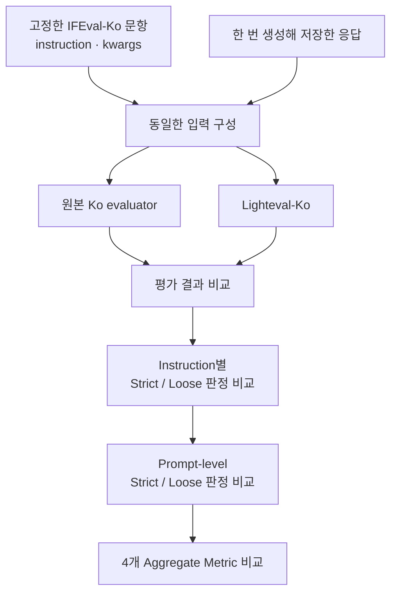

# 벤치마크 분석 보고서

## **1. 한 줄 요약: 무엇을 측정하는가**

IFEval-Ko는 한국어 프롬프트에 포함된 지시사항 중 프로그램으로 검증 가능한 조건(verifiable instructions)을 LLM이 얼마나 정확하게 준수하는지 측정하는 벤치마크입니다.

---

## **2. 출처: 논문, 저자, 연도, 공식 코드**

| 구분 | 내용 |
| --- | --- |
| 원본 논문 | Instruction-Following Evaluation for Large Language Models |
| 저자 | Jeffrey Zhou, Tianjian Lu, Swaroop Mishra, Siddhartha Brahma, Sujoy Basu, Yi Luan, Denny Zhou, Le Hou |
| 발표 연도 | arXiv. 2023-11-14 |
| 논문 | https://arxiv.org/abs/2311.07911 |
| **원본 IFEval 코드** | Google Research — 논문의 영어 평가 코드 |
| **IFEval-Ko 채점 코드** | Allganize — 한국어 채점 기준 구현 |
| **기여 대상** | Hugging Face Lighteval — IFEval-Ko를 연결할 평가 도구 |
| **팀 작업 저장소** | Hugging-Face-KREW/lighteval — 구현과 팀 리뷰를 진행할 포크 |

---

## **3. 데이터셋: Hugging Face ID, config와 split, 문항 수, 필드, 예시 2개**

### **3.1. 기본 정보**

| 항목 | 영어 IFEval | IFEval-Ko |
| --- | --- | --- |
| Hugging Face ID | **`google/IFEval`** | **`allganize/IFEval-Ko`** |
| Config | **`default`** | **`default`** |
| 평가에 사용하는 split | **`train`** | **`train`** |
| 문항 수 | 541 | 342 |
| 주요 저장 형식 | JSONL | Parquet |
| 모델 입력 | **`prompt`** | **`prompt`** |
| 채점 정보 | **`instruction_id_list`**, **`kwargs`** | **`instruction_id_list`**, **`kwargs`** |

### **3.2. 필드**

| 필드 | 의미 |
| --- | --- |
| **`key`** | 문항 식별자. 행 순서와 구분한다. |
| **`prompt`** | 모델에게 제시하는 자연어 요청 |
| **`instruction_id_list`** | 해당 응답에서 검사할 instruction 유형의 목록 |
| **`kwargs`** | 각 instruction에 대응하는 키워드, 횟수, 비교 조건 등의 파라미터 |

### **3.3. 예시 1 — key 3345**

프롬프트의 핵심 조건은 ‘강도’를 최소 두 번 사용하고, bullet 두 개를 작성하며, 지정 금지어를 사용하지 않는 것이다. 그러나 첫 번째 검사 파라미터에는 **`robber`**가 남아 있었다.

```
{
  "key": 3345,
  "instruction_id_list": [
    "keywords:frequency",
    "detectable_format:number_bullet_lists",
    "keywords:forbidden_words"
  ],
  "kwargs": [
    {"keyword": "robber", "frequency": 2, "relation": "at least"},
    {"num_bullets": 2},
    {"forbidden_words": ["죽이다", "도살", "점령", "침략"]}
  ]
}
```

검사기는 요청의 의미를 다시 번역하지 않고 **`kwargs`**의 문자열을 검색한다.

### **3.4. 예시 2 — key 3442**

수수께끼에 답하되 20단어 미만으로 작성하고 이중 꺾쇠괄호 제목을 포함하도록 요구하는 문항이다.

[실험: key 3442]

```
{
  "key": 3442,
  "instruction_id_list": [
    "length_constraints:number_words",
    "detectable_format:title"
  ],
  "kwargs": [
    {"num_words": 20, "relation": "less than"},
    {}
  ]
}
```

**`less than 20`**은 20개 이하가 아니라 20개 미만이다. 단어 수의 계산 단위가 달라지면 이 경계에서 판정이 달라질 수 있다.

---

## **4. 라이선스와 접근: 라이선스, 약관 동의 필요 여부**

| 대상 | 확인 내용 |
| --- | --- |
| 영어 IFEval 데이터 | Apache-2.0 |
| IFEval-Ko 데이터 | Apache-2.0, 원본 라이선스를 따름 |
| Ko **`instructions.py`** | Google Research의 Apache-2.0 저작권·라이선스 헤더 유지 |
| 기여 대상 LightEval | 저장소 최상위 LICENSE: MIT |

---

## **5. 공식 평가 방식**

### **5.1. 프롬프트와 few-shot**

영어 Harness와 Ko task YAML 모두  **`doc_to_text: prompt`**, **`output_type: generate_until`**, **`num_fewshot: 0`**을 사용한다.

논문에서 등장하는 few-shot prompting은 평가 대상 모델에게 예시를 주는 설정이 아니라, 데이터 제작 중 프롬프트를 필터링하고 재작성하는 과정이다.

확인한 task YAML의 생성 설정은 아래와 같다 이는 실행 구현의 설정이다.

| 항목 | 영어 Harness | Ko reference |
| --- | --- | --- |
| **`do_sample`** | **`false`** | **`false`** |
| **`temperature`** | **`0.0`** | **`0.0`** |
| **`max_gen_toks`** | 1280 | 1280 |
| **`until`** | **`[]`** | **`["<end_of_turn>", "<|im_end|>"]`** |

1,280은 생성 토큰 수 제한이며 checker가 세는 단어 수와는 다른 단위다. 실제 통합 검증에서는 같은 모델·chat template·생성 및 종료 설정을 기록하고 맞춘다.

### **5.2. 채점 경로와 정답 추출**

```
문항의 prompt → 응답 생성 또는 저장된 응답 입력
→ instruction_id와 kwargs로 checker 구성
→ 각 instruction의 strict / loose 판정
→ prompt-level / instruction-level 집계
```

프레임워크의 답변 추출·후처리도 reference와 비교할 평가 경로에 포함한다.

### **5.3. Strict와 loose**

Strict는 evaluator의 기본 전처리를 거친 응답을 대상으로 검사한다.

IFEval-Ko에서는 strict와 loose 모두 검사 전에 NFC 정규화를 적용한다.

Loose는 원본 응답에 `*` 제거, 첫 줄 제거, 마지막 줄 제거를 개별적으로 적용하거나 조합하여 총 8가지 후보를 검사한다. 다만 변환 결과가 중복될 수 있어 실제로 생성되는 서로 다른 문자열은 8개보다 적을 수 있다. 빈 문자열은 통과로 인정하지 않으며, `#`, `>`, `-` 등 다른 Markdown 기호까지 모두 제거하는 방식은 사용하지 않는다.

각 instruction은 독립적으로 검사하므로 서로 다른 후보에서 조건을 충족하더라도 통과로 인정된다. 즉, 모든 조건을 하나의 후보 문자열에서 동시에 만족할 필요는 없다.

```
instruction별 loose = 후보 중 하나라도 해당 checker를 통과
prompt-level loose = 모든 instruction의 loose가 True
```

이 후보 생성과 집계 방식 자체를 LightEval에서도 유지해야 한다.

### **5.4. 네 가지 지표**

| 지표 | 의미 |
| --- | --- |
| **`prompt_level_strict_acc`** | 모든 instruction을 strict로 통과한 문항의 비율 |
| **`inst_level_strict_acc`** | 전체 개별 instruction 중 strict 통과 비율 |
| **`prompt_level_loose_acc`** | 모든 instruction을 loose로 통과한 문항의 비율 |
| **`inst_level_loose_acc`** | 전체 개별 instruction 중 loose 통과 비율 |

전체 문항 수를 NN, 문항 ii에 포함된 instruction 수를 mim_i라고 할 때, prompt-level 점수는 전체 문항 중 모든 instruction을 충족한 문항의 비율로 계산한다. instruction-level 점수는 전체 instruction 수 $\sum m_i$를 기준으로 통과한 instruction의 비율을 산출한다. 따라서 문항별 통과율을 단순 평균하는 방식과는 차이가 있다. 네 가지 평가 지표 모두 점수가 높을수록 좋은 성능을 의미한다.

### **5.5. 논문 보고 수치**

원본 논문 Table 3의 영어 IFEval 결과이며 단위는 %다.

| 모델 | Prompt strict | Instruction strict | Prompt loose | Instruction loose |
| --- | --- | --- | --- | --- |
| GPT-4 | 76.89 | 83.57 | 79.30 | 85.37 |
| PaLM 2 S | 43.07 | 55.76 | 46.95 | 59.11 |

각 결과는 2023년 11월과 8월에 수집된 응답을 바탕으로 산출되었다. 해당 수치는 당시 영어 IFEval의 성능을 보여주는 참고 자료로, 한국어 데이터나 다른 모델의 목표 점수로 직접 활용하기에는 적절하지 않다. IFEval-Ko의 성능을 수치로 비교하려면 동일한 모델과 데이터, 평가 설정에서 얻은 결과를 별도로 확보해야 한다.

---

## **6. 기존 구현과 이번 구현 범위**

| 구현 | 이번 작업에서의 역할 |
| --- | --- |
| Google Research IFEval | 원본 방법론·영어 reference 코드 |
| EleutherAI lm-evaluation-harness | 기존 영어 evaluator 비교 및 모델 실행 reference |
| Allganize IFEval-Ko | **한국어 채점 동작의 직접적인 reference** |
| Hugging-Face-KREW/lighteval | **실제 이식·기여 대상** |

원저자 코드는 **`instruction_following_eval/`**, Harness의 영어 task는 **`lm_eval/tasks/ifeval/`**, Ko 코드는 Hugging Face 저장소의 **`ifeval_ko/`**에 있다.

이번 구현 범위는 아래 원칙을 확정한다.

- Ko의 데이터·문자열 검사·단어/문장 수·strict/loose 동작을 유지한다.
- LightEval에 옮기는 과정에서 원본과 달라진 부분은 수정한다.
- 원본 Ko의 기준을 바꾸는 개선은 기본 구현과 분리한다.
- 데이터 오류와 평가 기준에 관한 관찰은 Known Issues로 남긴다.
- 제작자 제보는 초안을 공유해 멘토 검토 후 진행한다.

즉 코드 구조를 LightEval에 맞게 바꾸는 것은 가능하지만, 그 과정에서 **`split()`**을 다른 기준으로 교체하거나 특정 key의 검사 단어를 고치지는 않는다.

## **7. 중복 확인: 검색한 키워드와 결과**

### **7.1. 검색 기록**

검색 대상은 **`Hugging-Face-KREW/lighteval`**, **`huggingface/lighteval`**, **`EleutherAI/lm-evaluation-harness`**다. 조회 시점에 반환된 범위만 기록한다.

| 검색 | 대상 | 결과 |
| --- | --- | --- |
| **`"IFEval-Ko" OR "ifeval_ko" OR "allganize/IFEval-Ko"`** | 세 저장소의 issue | 결과 반환 없음 |
| 동일 검색어 | 세 저장소의 PR, all 상태 | 결과 반환 없음 |
| **`IFEval Korean`** | 세 저장소의 issue | 결과 반환 없음 |
| **`IFEval in:title`** | upstream LightEval PR | 기존 영어 IFEval 관련 PR 확인 |

정확한 **`IFEval-Ko`** 명칭은 GitHub issue 검색에서도 위 세 저장소 범위에서 0건이 반환되었다.

---

### **7.2. 관련 선행 작업**

- LightEval PR #268: 영어 IFEval 데이터 저장소 변경.
- LightEval PR #791·#792: IFEval 평가 전 reasoning 태그 처리.
- LightEval PR #1013: IFEval NLTK import 문제 수정.

위 PR들은 IFEval-Ko의 중복 구현 사례가 아니라, 기존 평가 방식과 전처리, 의존성 관련 작업을 참고하기 위해 조사했다.

Allganize Community Discussion #2에서는 `prompt_to_repeat`, `section_spliter` 등의 번역 오류가 제보되었고, 제작자가 이를 수정했다는 답변을 남겼다. 이를 보면 데이터 오류는 제작자에게 직접 제보할 수 있으며, 다만 key 3345의 수정 여부는 별도로 확인해야 한다.

---

## **8. 구현상 어려운 점과 Known Issues**

### **8.1. 핵심 난점**

첫째, 같은 prompt를 사용해도 kwargs 순서·필터링·fallback 처리에서 판정이 달라질 수 있다. reference의 입력 처리까지 비교해야 한다. 예를 들어 Ko evaluator는 **`if v`**로 kwargs를 걸러내므로, 이를 별도 검증 없이 다른 조건으로 바꾸는 것은 피한다.

둘째, checker 직접 호출과 실제 evaluator 호출은 전처리 경로가 다를 수 있다. 후보 생성, 빈 응답 처리, 최종 응답 추출, 집계까지 포함한 테스트가 필요하다.

셋째, 원본 Ko에서 어색해 보이는 결과라도 이번 목표에서는 재현해야 한다. 개선 의견은 남기되 reference가 실패시키는 입력을 새 구현만 성공시키는 방식으로 변경하지 않는다.

넷째, 버전과 난수·언어 판별 의존성 등 실행 조건을 고정해야 한다. 재현되지 않는 항목은 예외로 감추지 않고 원인과 조건을 기록한다.

### **8.2. 기존 실험에서 확인한 Known Issues**

아래는 현재까지의 실험 결과이다. (점수는 strict / loose 순으로 표기)
key 3345는 영문과 국문 각각에 맞는 응답 사용,

나머지 문항은 두 evaluator 모두 동일한 한국어 응답을 넣어 테스트했다.

본 실험은 모델 간의 성능 비교가 목적이 아니며, 평가기 간의 채점 편차를 확인하기 위해 진행되었다.

| Key | 문제 유형 | 기존 실험의 영향 | 이번 처리 |
| --- | --- | --- | --- |
| 3345 | DATA: ‘강도’/**`robber`** 불일치 | 영어 응답 2회 → 통과/통과, Ko의 ‘강도’ 응답에서 robber 0회 → 실패/실패. keyword만 바꾼 대조군은 통과/통과 | 원본 조건 유지, 제보 초안 작성 후 멘토 검토 |
| 3442 | 평가 기준: 쉼표·공백 경계 | 공백 없는 목록에서 Original 20, Ko 18. **`<20`**에서 실패/실패 ↔ 통과/통과 | Ko 공백 기준 유지, 차이를 문서화 |
| 349 | 평가 기준: 인용 기호 **`>`**  | Original 39, Ko 40. **`<40`**에서 통과/통과 ↔ 실패/실패 | Markdown 제거 규칙을 추가하지 않고 분석·제안 |
| 136 | 평가 기준: bullet·loose 조합 | 내용 99개에 bullet 9개. Original 99, Ko 108. Ko는 기호·줄 배치에 따라 실패/통과 또는 실패/실패 | 기존 변환·집계 방식 재현, 대조군 보존 |

NFC나 한국어 목록 처리처럼 원본 Ko에 이미 포함된 adaptation은 유지 대상이며, 그 자체를 새 오류로 분류하지 않는다.

### **8.3. 영향 범위 집계 — 추가 작업**

현재까지는 위 key들에서 발생한 판정 차이를 실험한 상태이며, 전체 데이터셋에서 해당 규칙이 적용되는 문항 수나 실제 모델 평가 점수에 미치는 영향은 아직 확인하지 못했다.

이후 IFEval-Ko의 revision을 고정하고 다음 항목을 집계할 예정이다.

- `length_constraints:number_words`가 포함된 문항 수
- 해당 문항 중 bullet·강조 instruction이 함께 포함된 문항 수
- 키워드 빈도 instruction이 포함된 문항 수
- 실제 테스트에서 판정 차이가 확인된 고유 key 수

다만 특정 규칙이 적용되는 문항이 모두 평가 결과에 영향을 받는 것은 아니다. Markdown은 별도의 형식 지시가 없어도 응답에 포함될 수 있으므로, instruction 간 교집합만으로 전체 영향 범위를 판단하기도 어렵다.

추가 실험은 대표 사례와 규칙별 적용 범위를 확인하는 수준으로 진행하고, 그 결과를 2주 차 보고서에 정리한 뒤 Lighteval 구현에 집중할 계획이다.

---

## **9. 검증 계획: 모델 조사, 선정 근거, 비교 방법과 완료 기준**

### **9.1. 검증에 사용할 모델 조사**

IFEval-Ko의 채점기는 문항에 포함된 instruction과 모델 응답을 받아 준수 여부를 판정한다. 따라서 모델 선정에서는 한국어 응답 생성, 실행 환경, 모델·토크나이저 버전 고정, 평가 도구와의 연결을 함께 살펴본다. 아래는 이번 구현 검증을 위해 검토한 후보이다.

| 모델 ID | 규모 | 조사 내용 | 이번 검증에서의 용도 |
| --- | --- | --- | --- |
| `HuggingFaceTB/SmolLM2-135M-Instruct` | 0.135B | 소형 instruction 모델이다. 공식 카드에서는 주로 영어를 이해하고 생성한다고 설명한다. | 설치·로딩·출력 저장 등 실행 경로 점검 |
| `Qwen/Qwen2.5-0.5B-Instruct` | 0.5B | 한국어를 포함한 다국어 지원과 Transformers 실행 예제가 제공된다. | 자원이 부족할 때 사용할 경량 대안 |
| `Qwen/Qwen2.5-1.5B-Instruct` | 약 1.54B | 한국어 지원이 명시된 instruction 모델이다. 공식 tokenizer의 chat template를 이용한 생성 예제가 제공된다. | **통합 실행과 전체 평가의 우선 후보** |
| `google/gemma-3-1b-it` | 1B | 소형 instruction 모델로, Hugging Face에서 사용 조건 동의가 필요하다. | 다른 모델 계열의 응답으로 확인할 때 사용할 보조 후보 |
| `LGAI-EXAONE/EXAONE-3.5-2.4B-Instruct` | 2.4B | 영어·한국어 bilingual 모델이다. 공식 예제는 `trust_remote_code=True`를 사용하며, 권장 system prompt도 제시한다. | 한국어 모델의 응답을 추가 검증할 때 사용할 후보 |
| `google/gemma-3-4b-it` | 4B | Allganize의 IFEval-Ko README에 실행 예시 모델로 등장한다. 모델 접근 조건과 텍스트 생성 경로의 호환성을 확인해야 한다. | 공식 실행 예시를 참고한 추가 통합 검증 |
| `Qwen/Qwen2.5-3B-Instruct`, `Qwen/Qwen2.5-7B-Instruct` | 3B / 7B | 같은 Qwen2.5 instruction 계열의 더 큰 모델이다. | 주 모델 검증 이후 자원이 확보되면 검토 |
| `meta-llama/Llama-3.2-1B-Instruct` | 1B급 | 공식 지원 언어 목록에 한국어가 포함되어 있지 않다. | 한국어 주 검증 모델로는 우선순위를 낮춤 |
| `Qwen/Qwen3-0.6B` | 0.6B | thinking / non-thinking 전환을 지원한다. 사용 시 해당 모드와 최종 응답 추출 범위를 추가로 고정해야 한다. | 이번 기본 검증에서는 보류 |

우선 주 모델 한 개로 전체 경로를 검증하고, 필요할 때 다른 계열의 모델을 추가한다. 모델 카드에 나오는 영어 IFEval 점수나 실행 조건이 충분히 공개되지 않은 외부 점수는 후보를 조사하는 참고 자료로만 사용한다.

### **9.2. 현재 사용한 모델과 본 평가 후보**

현재 실행 해본 모델은 `HuggingFaceTB/SmolLM2-135M-Instruct`다. 작성자의 개발 환경에서 `batch_size=1`로 ARC Easy 10문항을 실행해보았다.

본 초안은 **SmolLM2를 환경 점검용으로 두고, `Qwen/Qwen2.5-1.5B-Instruct`를 IFEval-Ko 통합 실행과 전체 평가의 우선 후보로 제안한다.** 팀의 최종 모델과 GPU·backend·dtype·revision은 리뷰 및 확정 후 기록에 반영한다.

| 구분 | 모델 | 현재 상태 |
| --- | --- | --- |
| 기존 환경 점검 | `HuggingFaceTB/SmolLM2-135M-Instruct` | 작성자의 ARC Easy 소규모 실행 기록 있음 |
| IFEval-Ko 주 검증 | `Qwen/Qwen2.5-1.5B-Instruct` | 초안의 우선 후보. 팀 합의와 실행 환경 확인 필요 |
| 경량 대안 | `Qwen/Qwen2.5-0.5B-Instruct` | 주 후보의 실행 부담이 클 때 검토 |
| 다른 계열의 추가 검증 | Gemma 3 1B 또는 EXAONE 3.5 2.4B | 기본 검증 이후 선택적으로 진행 |

Qwen2.5-1.5B-Instruct를 우선 검토하는 이유는 한국어 지원이 명시되어 있고, instruction tuning과 공식 chat template를 갖추고 있기 때문이다. 1.54B 규모의 모델을 기준으로 먼저 실행 경로를 정리한 뒤, 소규모 실행에서 메모리 사용량과 응답 생성 시간을 측정해 전체 평가 가능 여부를 판단한다.

이번 작업에서는 높은 점수를 내는 모델보다 **같은 조건으로 응답을 생성하고 보관할 수 있는 모델**이 필요하다. 외부에 동일 모델의 IFEval-Ko 점수가 없어도, 저장한 응답을 원본 Ko evaluator로 채점하면 이식 구현과 비교할 기준값을 얻을 수 있다.

Qwen3는 thinking 설정과 응답 추출 규칙, EXAONE은 remote code와 system prompt를 추가로 확인해야 한다. 첫 통합 실행은 기존 초안의 Qwen2.5를 중심으로 진행하고, 다른 모델의 설정은 후속 검증에서 다룬다.

### **9.3. 현재까지 확보한 검증 자료**

기존 보고서에는 영어와 한국어 evaluator를 각각 대상으로 한 86개 테스트가 기록되어 있다. 구성은 다음과 같다.

| 테스트 구분 | 각 evaluator의 테스트 수 |
| --- | --- |
| 실제 데이터셋 조건 | 46 |
| 메모리 override | 2 |
| 합성 fixture | 38 |
| **합계** | **86** |

이 수치는 evaluator 동작을 확인한 테스트 건수다. 모델 성능 평가와는 구분하며, 테스트 건수와 고유 dataset key 수도 별도로 집계한다. 메모리 override와 합성 fixture는 실제 데이터셋을 그대로 사용한 결과와 구분해 표시한다.

해당 기록에는 Lighteval evaluator의 실행 결과가 포함되어 있지 않다. 기존 영어·한국어 비교에서 확보한 사례를 바탕으로 **원본 Ko evaluator와 새로 구현한 Lighteval-Ko를 비교하는 회귀 테스트**를 구성해볼 필요가 있다.

언어별로 의도된 차이가 있는 기존 영어·한국어 평가 결과를 그대로 일치 기준으로 사용하지 않는다.

### **9.4. 비교 방법: 생성과 채점을 분리**

검증의 중심은 동일한 입력에 대한 두 Ko evaluator의 판정 일치다.



모델 응답은 한 번 생성해 저장하고 양쪽 채점에 재사용한다. 두 도구에서 응답을 따로 생성하면 생성 결과의 차이까지 섞이므로 채점기 비교는 저장된 응답을 기준으로 진행한다.

응답을 전달하는 비교 코드에서는 공백·Markdown·한국어 문자를 임의로 정리하지 않는다. 원본 응답을 보관한 상태에서 각 evaluator가 정해진 전처리를 수행하도록 한다. 원본 Ko 구현은 strict와 loose 진입 시 NFC를 적용하고, loose에서는 변환 후보마다 instruction을 검사한다. 이 처리 순서도 비교 대상에 포함한다.

판정은 `(key, instruction_index, instruction_id)` 단위로 맞춘다. 한 문항에 같은 종류의 instruction이 여러 번 등장하는 경우에도 각각의 kwargs와 판정을 구별할 수 있도록 순서를 보존한다. 원본 kwargs와 evaluator에 실제 전달된 kwargs를 함께 기록하고, 반복 실행에서 판정이 달라지는 사례는 의존성·난수 사용·실행 순서를 먼저 확인한다.

Lighteval 쪽에서는 checker 함수만 따로 호출하는 테스트와 함께, **실제 등록된 task의 문항 변환·scorer 연결·집계 경로**도 확인한다. 공통 비교 코드가 양쪽 결과를 대신 계산하는 방식은 피하고, 각 구현이 반환한 결과를 독립적으로 수집한다.

### **9.5. 단계별 실행 계획**

| 단계 | 실행 내용 | 완료 확인 |
| --- | --- | --- |
| 1. reference와 환경 고정 | Ko 데이터·채점 코드 revision, Harness·Lighteval commit, 모델·tokenizer revision과 의존성 기록 | 실행 조건을 다시 구성할 수 있는 manifest 확보 |
| 2. 전체 문항 로딩·구조 확인 | 모든 문항의 key, prompt, instruction 순서, kwargs 대응, 필수 필드 확인 | 누락·중복·연결 오류를 확인하고 처리 상태 기록 |
| 3. 고정 응답 회귀 테스트 | 기존 반례와 정상·실패·경계 입력을 두 Ko evaluator로 채점 | 테스트별 예상 동작 확인 및 instruction·prompt 판정 일치 |
| 4. 소규모 모델 통합 실행 | 고정한 20개 문항을 대상으로 생성·저장·재채점 수행 | chat template, scorer 연결, 종료 조건, 잘림, 메모리와 실행 오류 확인 |
| 5. 주 모델 전체 평가 | 고정 revision의 전체 문항 응답을 생성·저장하고 양쪽에서 재채점 | 전체 key 처리, 네 지표와 불일치 목록 확보 |
| 6. 기존 영어 task 회귀 확인 | 영어 IFEval의 고정 입력 테스트를 변경 전후 비교 | 공통 코드 변경으로 인한 의도하지 않은 판정 변화 없음 |

20문항은 통합 실행을 점검하기 위한 표본이다. 선택한 key 목록을 저장하고 길이·키워드·형식·복수 instruction 사례가 포함되도록 구성한다. checker별 세부 동작은 별도의 고정 응답 테스트로 확인한다.

고정 응답 테스트에는 통과·실패 사례가 모두 필요하다. 특히 다음 내용을 포함한다.

| 확인할 동작 | 입력 구성 |
| --- | --- |
| 기본 판정 | 조건을 충족하는 응답과 위반하는 응답 |
| 경계값 | 길이·빈도 조건의 경계 바로 아래, 경계값, 바로 위 |
| 빈 응답 | 빈 문자열, 공백·줄바꿈만 있는 응답 |
| 한국어 전처리 | NFC/NFD, 조사 결합, 띄어쓰기 차이를 포함한 응답 |
| loose 변환 | `*`, 첫 줄·마지막 줄, 한 줄 응답, 변환 후 빈 후보 |
| 복수 instruction | 서로 다른 loose 후보에서 각각 통과하는 조건 조합 |
| kwargs 처리 | 원본 데이터 조건과 별도로 표시한 override·오류 입력 |
| 집계 | instruction 수가 서로 다른 문항들의 통과·실패 조합 |

모든 checker가 항상 True 또는 항상 False를 반환하는 잘못된 구현도 실패하도록 예상 결과를 지정한다. 원본 동작과 사람이 기대하는 판정이 다른 사례는 Known Issues에 분리해 기록하고, 이식 검증의 비교 기준은 고정한 원본 구현으로 유지한다.

### **9.6. 생성 설정과 재현 기록**

현재 확인한 Allganize task 설정은 `train` split, 0-shot, sampling 비활성화, `temperature: 0.0`, `max_gen_toks: 1280`을 사용한다. 종료 문자열은 `<end_of_turn>`과 `<|im_end|>`다. 이를 출발점으로 삼되, 실제 실행에서는 고정한 revision의 설정과 선택한 backend에 전달된 값을 함께 기록한다.

| 항목 | 기록·고정할 내용 |
| --- | --- |
| 데이터 | `allganize/IFEval-Ko`, revision, config, split, 실제 로딩한 key 목록과 문항 수 |
| 기준 코드 | Allganize `ifeval_ko` 코드 revision, lm-evaluation-harness commit |
| 이식 코드 | Lighteval commit, task 이름, 변경 파일 |
| 모델 | 전체 모델 ID, 모델·tokenizer revision, dtype, 양자화 여부 |
| 실행 환경 | CPU/GPU, 메모리, backend, Python·PyTorch·Transformers 및 채점 의존성 버전 |
| 프롬프트 | 원본 prompt, few-shot 수, system prompt, chat template, 최종 렌더링된 입력 |
| 생성 | sampling 여부, seed, 최대 생성 토큰, EOS token ID, stop 문자열과 처리 방식 |
| 응답 | 생성 token ID, 원본 출력, 채점에 전달한 응답, 생성 길이, 종료 사유 |
| 재현 자료 | 실행 명령, 설정 파일, 입력·응답 파일 hash, 실행 로그 |

공식 데이터 카드에는 `default` config의 `train` split이 342문항으로 표시되어 있다. 전체 평가의 분모와 완료 여부는 최종 고정 revision을 실제로 로딩한 결과로 결정한다.

chat template는 한 번만 적용하고, 모델 입력과 채점할 assistant 응답의 경계를 확인한다. backend의 EOS·stop 처리와 evaluator 자체 전처리를 구분해 기록한다. Qwen 공식 예제처럼 생성된 토큰에서 입력 토큰 구간을 제외하는 처리도 확인 대상이다.

최대 생성 길이에 도달한 응답은 잘림 여부를 표시한 채 양쪽에서 동일하게 채점한다. 길이 상한을 늘리는 실험은 별도의 설정과 결과로 남긴다. 반면 OOM·timeout 등으로 생성 자체가 실패한 문항은 실패 응답으로 치환하거나 분모에서 조용히 제외하지 않고 실행 오류로 기록한다.

소규모 실행에서 확인한 메모리 사용량과 생성 시간을 기준으로 전체 실행 환경을 결정한다. 모델이나 backend를 바꾸면 변경 사유와 새 설정을 남기고, 모델별·설정별 응답 파일을 분리한다.

### **9.7. 비교 수치와 합격 기준**

모델 성능은 다음 네 지표로 보고한다. prompt-level은 모든 instruction을 통과한 문항 수를 전체 문항 수로 나누고, instruction-level은 통과 instruction 수를 전체 instruction 수로 나눈다. 원본 구현도 instruction별 판정 목록을 합쳐 instruction-level 점수를 계산한다.

| 지표 | 원본 Ko evaluator | Lighteval-Ko | 차이 |
| --- | --- | --- | --- |
| `prompt_level_strict_acc` | 측정 후 기재 | 측정 후 기재 | 측정 후 기재 |
| `inst_level_strict_acc` | 측정 후 기재 | 측정 후 기재 | 측정 후 기재 |
| `prompt_level_loose_acc` | 측정 후 기재 | 측정 후 기재 | 측정 후 기재 |
| `inst_level_loose_acc` | 측정 후 기재 | 측정 후 기재 | 측정 후 기재 |

총점만 같아도 문항별 불일치가 상쇄되었을 수 있다. 따라서 합격 여부는 개별 판정과 분모를 먼저 비교한 뒤 집계 점수로 확인한다.

| 검증 항목 | 제안하는 합격 기준 |
| --- | --- |
| 문항·instruction 대응 | 동일 key 목록, instruction 순서, kwargs 대응 유지 |
| instruction별 strict / loose | 고정 응답 테스트와 전체 평가 응답에서 판정 일치율 100% |
| prompt-level strict / loose | 모든 비교 대상 문항의 Boolean 일치 |
| 집계 분자·분모 | 통과 문항 수, 전체 문항 수, 통과 instruction 수, 전체 instruction 수 일치 |
| 네 집계 지표 | 원시 집계값 일치. 부동소수점 비교는 절대 오차 `1e-12` 이하를 제안 |
| 회귀 테스트 | 정상·실패·경계 입력의 예상 결과 충족 |
| 실행 안정성 | 미처리 import·schema·scorer 연결 오류와 누락 응답 없음 |
| 기존 영어 task | 공통 코드 변경 전후 고정 입력의 판정 유지 |

여기서 **100%는 모델의 정답률이 아니라 두 evaluator의 판정 일치율**이다. 기준 evaluator에서 실패한 응답은 Lighteval에서도 같은 조건으로 실패해야 한다. 이 기준이 보장하는 범위는 실제 실행한 테스트와 저장된 응답 집합이다.

원본 evaluator 자체에서 예외가 발생한 문항은 입력과 예외 내용을 남기고 Known Issues로 분리한다. 양쪽에서 같은 예외가 발생해도 해당 문항의 채점 검증은 미완료로 처리한다. 전체 문항에 대한 처리 방침이 정리되기 전에는 전체 평가 완료로 표시하지 않는다.
